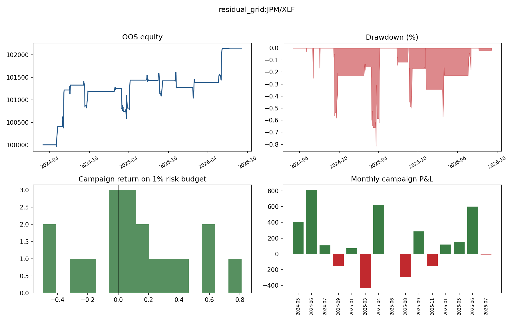
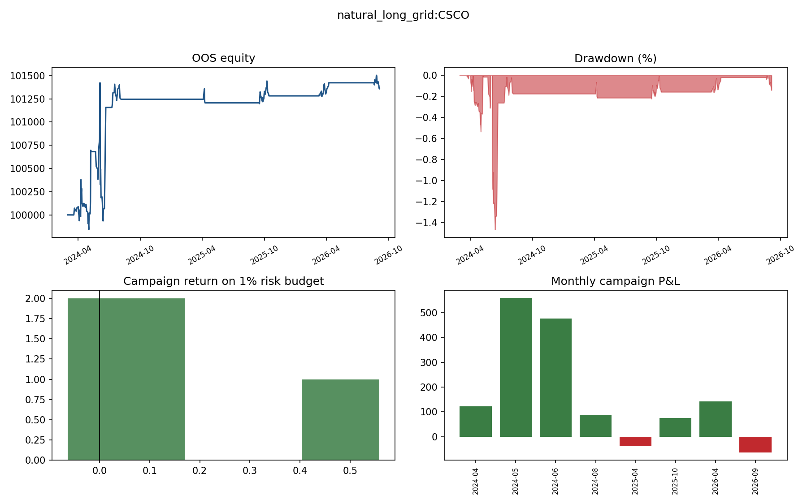
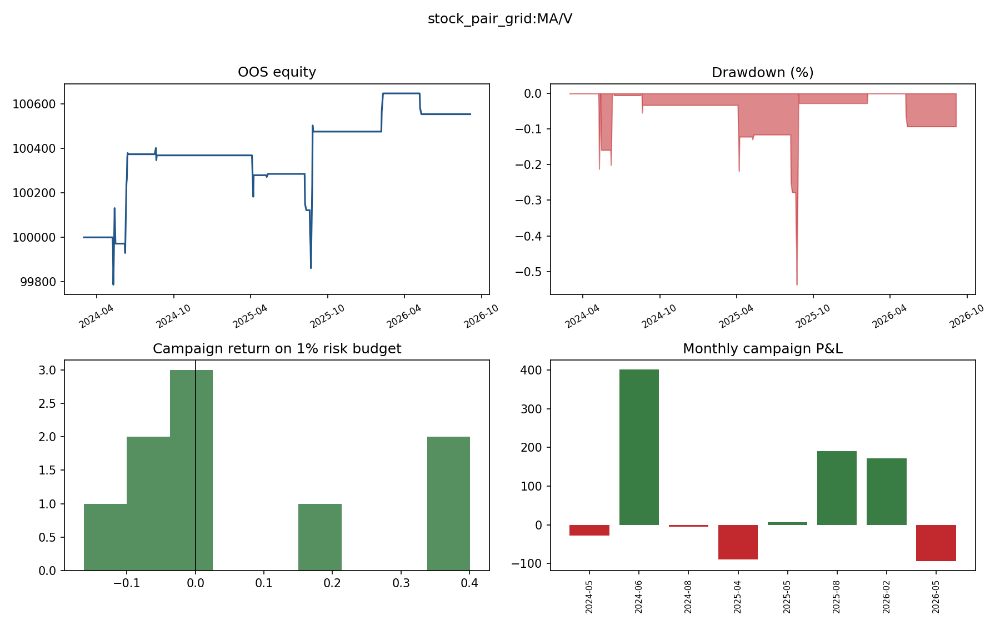
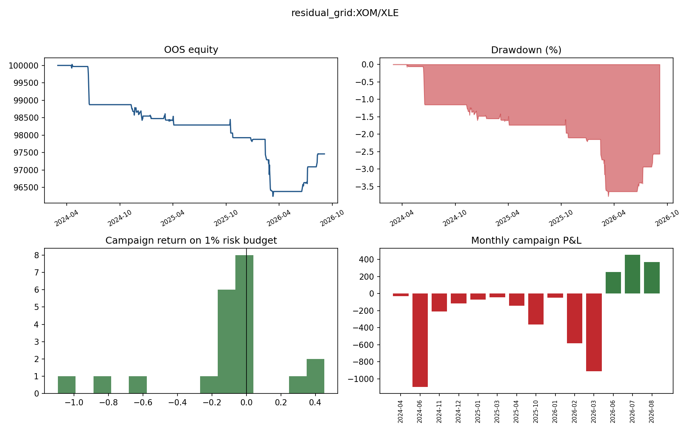

# Phase 2B — Candidate Deep Dive

The headline and campaign tables in this document use the preserved Phase 2A OOS sample. Signal-density tables are explicitly labeled as the longer Phase 2B diagnostic sample.

## residual_grid:JPM/XLF

Classification: **PROMISING_BUT_UNDERPOWERED**. Phase 2A OOS return 2.13%, PF 2.49, expectancy $119, max drawdown -0.82%, 18 campaigns.

### Monthly OOS campaign P&L

| Month | P&L | Campaigns |
| --- | --- | --- |
| 2024-03 | $0 | 0 |
| 2024-04 | $0 | 0 |
| 2024-05 | $408 | 1 |
| 2024-06 | $812 | 1 |
| 2024-07 | $109 | 1 |
| 2024-08 | $0 | 0 |
| 2024-09 | $-147 | 2 |
| 2024-10 | $0 | 0 |
| 2024-11 | $0 | 0 |
| 2024-12 | $0 | 0 |
| 2025-01 | $70 | 1 |
| 2025-02 | $0 | 0 |
| 2025-03 | $-434 | 3 |
| 2025-04 | $621 | 1 |
| 2025-05 | $0 | 0 |
| 2025-06 | $-6 | 1 |
| 2025-07 | $0 | 0 |
| 2025-08 | $-295 | 1 |
| 2025-09 | $285 | 1 |
| 2025-10 | $0 | 0 |
| 2025-11 | $-152 | 1 |
| 2025-12 | $0 | 0 |
| 2026-01 | $117 | 1 |
| 2026-02 | $0 | 0 |
| 2026-03 | $0 | 0 |
| 2026-04 | $0 | 0 |
| 2026-05 | $155 | 1 |
| 2026-06 | $600 | 1 |
| 2026-07 | $-9 | 1 |
| 2026-08 | $0 | 0 |
| 2026-09 | $0 | 0 |

### Campaign-level detail

| Entry | Exit | Hours | P&L | Mode | Direction | Exit type | MAE | MFE | R |
| --- | --- | --- | --- | --- | --- | --- | --- | --- | --- |
| 2024-05-02 | 2024-05-08 | 144.0 | $408 | grid_mean_reversion | short_residual | take_profit | $-30 | $415 | 0.41 |
| 2024-05-30 | 2024-06-06 | 168.0 | $812 | grid_mean_reversion | short_residual | time_stop | $-22 | $833 | 0.81 |
| 2024-07-02 | 2024-07-05 | 72.0 | $109 | grid_mean_reversion | short_residual | kill | $-90 | $117 | 0.11 |
| 2024-09-05 | 2024-09-11 | 144.0 | $-460 | grid_mean_reversion | long_residual | kill | $-482 | $82 | -0.46 |
| 2024-09-18 | 2024-09-25 | 168.0 | $312 | grid_mean_reversion | long_residual | time_stop | $-48 | $340 | 0.31 |
| 2025-01-24 | 2025-01-31 | 168.0 | $70 | grid_mean_reversion | short_residual | time_stop | $20 | $99 | 0.07 |
| 2025-02-27 | 2025-03-04 | 120.0 | $-493 | hybrid_breakout | long_residual | breakout_exit | $-493 | $-96 | -0.49 |
| 2025-03-05 | 2025-03-06 | 24.0 | $-18 | breakout_continuation | short_residual | breakout_exit | $-18 | $79 | -0.02 |
| 2025-03-18 | 2025-03-25 | 168.0 | $77 | grid_mean_reversion | long_residual | time_stop | $-153 | $369 | 0.08 |
| 2025-04-03 | 2025-04-07 | 96.0 | $621 | grid_mean_reversion | long_residual | kill | $-34 | $625 | 0.62 |
| 2025-06-23 | 2025-06-30 | 168.0 | $-6 | grid_mean_reversion | short_residual | time_stop | $-31 | $113 | -0.01 |
| 2025-08-15 | 2025-08-22 | 168.0 | $-295 | grid_mean_reversion | long_residual | time_stop | $-295 | $167 | -0.30 |
| 2025-08-27 | 2025-09-03 | 168.0 | $285 | grid_mean_reversion | long_residual | time_stop | $-45 | $312 | 0.28 |
| 2025-10-31 | 2025-11-07 | 168.0 | $-152 | grid_mean_reversion | short_residual | time_stop | $-152 | $201 | -0.15 |
| 2026-01-22 | 2026-01-29 | 168.0 | $117 | grid_mean_reversion | long_residual | time_stop | $-232 | $197 | 0.12 |
| 2026-05-20 | 2026-05-27 | 168.0 | $155 | grid_mean_reversion | long_residual | time_stop | $67 | $194 | 0.16 |
| 2026-06-01 | 2026-06-08 | 168.0 | $600 | grid_mean_reversion | long_residual | time_stop | $-105 | $611 | 0.60 |
| 2026-07-07 | 2026-07-08 | 24.0 | $-9 | grid_mean_reversion | long_residual | kill | $-9 | $11 | -0.01 |

### Return distribution and concentration

| Quantile | Campaign R |
| --- | --- |
| 0% | -0.49 |
| 10% | -0.34 |
| 25% | -0.02 |
| 50% | 0.09 |
| 75% | 0.31 |
| 90% | 0.61 |
| 100% | 0.81 |

Top campaign/week/month shares of gross positive P&L: 22.76% / 22.76% / 25.55%.

### Grid, breakout, direction, and exit contribution

| Grid | Breakout | Hybrid | Failed breakout | Kill | Time stop | Long | Short | No-breakout return | No-breakout PF | Recommendation |
| --- | --- | --- | --- | --- | --- | --- | --- | --- | --- | --- |
| $2,645 | $-18 | $-493 | $0 | $262 | $1,975 | $912 | $1,222 | 3.21% | 4.49 | DISABLE_FOR_RESEARCH_BASELINE |

### Event proximity

Nearest event distance: 1 business days. Campaigns within 3/5/10 business days of any mapped event: 3/3/6. These counts describe proximity; configured exclusion rules were still applied.

### Phase 2B signal-density and sensitivity table

| Dimension | Values | Min trades | Max trades | Min exp. | Max exp. | Min PF | Max PF | Viable | Mean robust |
| --- | --- | --- | --- | --- | --- | --- | --- | --- | --- |
| adx_filter | True, False | 20 | 44 | $20 | $43 | 1.22 | 1.60 | 100.00% | 85.71% |
| beta_stability_threshold | 0.25, 0.35, 0.5 | 18 | 20 | $15 | $20 | 1.15 | 1.22 | 66.67% | 80.95% |
| correlation_threshold | 0.6, 0.65, 0.7, 0.75, 0.8 | 11 | 20 | $-57 | $25 | 0.38 | 1.27 | 80.00% | 80.00% |
| event_exclusion_days | 3, 5, 10 | 19 | 20 | $20 | $32 | 1.22 | 1.39 | 100.00% | 85.71% |
| grid_levels | 2, 3, 4, 5 | 20 | 20 | $18 | $46 | 1.21 | 1.46 | 100.00% | 85.71% |
| time_stop_days | 3, 5, 10 | 19 | 22 | $20 | $136 | 1.22 | 3.03 | 100.00% | 90.48% |
| z_entry | 1.2, 1.4, 1.6, 1.8, 2.0 | 8 | 25 | $9 | $178 | 1.09 | 4.31 | 60.00% | 71.43% |

## natural_long_grid:CSCO

Classification: **TOO_FEW_TRADES**. Phase 2A OOS return 1.36%, PF 14.24, expectancy $170, max drawdown -1.47%, 8 campaigns.

### Monthly OOS campaign P&L

| Month | P&L | Campaigns |
| --- | --- | --- |
| 2024-03 | $0 | 0 |
| 2024-04 | $123 | 1 |
| 2024-05 | $559 | 1 |
| 2024-06 | $476 | 1 |
| 2024-07 | $0 | 0 |
| 2024-08 | $88 | 1 |
| 2024-09 | $0 | 0 |
| 2024-10 | $0 | 0 |
| 2024-11 | $0 | 0 |
| 2024-12 | $0 | 0 |
| 2025-01 | $0 | 0 |
| 2025-02 | $0 | 0 |
| 2025-03 | $0 | 0 |
| 2025-04 | $-39 | 1 |
| 2025-05 | $0 | 0 |
| 2025-06 | $0 | 0 |
| 2025-07 | $0 | 0 |
| 2025-08 | $0 | 0 |
| 2025-09 | $0 | 0 |
| 2025-10 | $75 | 1 |
| 2025-11 | $0 | 0 |
| 2025-12 | $0 | 0 |
| 2026-01 | $0 | 0 |
| 2026-02 | $0 | 0 |
| 2026-03 | $0 | 0 |
| 2026-04 | $141 | 1 |
| 2026-05 | $0 | 0 |
| 2026-06 | $0 | 0 |
| 2026-07 | $0 | 0 |
| 2026-08 | $0 | 0 |
| 2026-09 | $-64 | 1 |

### Campaign-level detail

| Entry | Exit | Hours | P&L | Mode | Direction | Exit type | MAE | MFE | R |
| --- | --- | --- | --- | --- | --- | --- | --- | --- | --- |
| 2024-03-19 | 2024-04-16 | 672.0 | $123 | grid_mean_reversion | long_residual | time_stop | $-63 | $380 | 0.12 |
| 2024-04-19 | 2024-05-09 | 480.0 | $559 | grid_mean_reversion | long_residual | kill | $-281 | $574 | 0.56 |
| 2024-05-23 | 2024-06-21 | 696.0 | $476 | grid_mean_reversion | long_residual | time_stop | $-746 | $742 | 0.48 |
| 2024-07-10 | 2024-08-05 | 624.0 | $88 | grid_mean_reversion | long_residual | kill | $23 | $249 | 0.09 |
| 2025-04-07 | 2025-04-09 | 48.0 | $-39 | grid_mean_reversion | long_residual | kill | $-39 | $112 | -0.04 |
| 2025-09-16 | 2025-10-14 | 672.0 | $75 | grid_mean_reversion | long_residual | time_stop | $-9 | $235 | 0.08 |
| 2026-03-11 | 2026-04-08 | 672.0 | $141 | grid_mean_reversion | long_residual | time_stop | $-3 | $141 | 0.14 |
| 2026-08-20 | 2026-09-04 | 360.0 | $-64 | grid_mean_reversion | long_residual | end_of_sample | $-64 | $80 | -0.06 |

### Return distribution and concentration

| Quantile | Campaign R |
| --- | --- |
| 0% | -0.06 |
| 10% | -0.05 |
| 25% | 0.05 |
| 50% | 0.11 |
| 75% | 0.22 |
| 90% | 0.50 |
| 100% | 0.56 |

Top campaign/week/month shares of gross positive P&L: 38.20% / 38.20% / 38.20%.

### Grid, breakout, direction, and exit contribution

| Grid | Breakout | Hybrid | Failed breakout | Kill | Time stop | Long | Short | No-breakout return | No-breakout PF | Recommendation |
| --- | --- | --- | --- | --- | --- | --- | --- | --- | --- | --- |
| $1,360 | $0 | $0 | $0 | $608 | $816 | $1,360 | $0 | 1.36% | 14.24 | NO_EFFECT_OBSERVED |

### Event proximity

Nearest event distance: 2 business days. Campaigns within 3/5/10 business days of any mapped event: 2/2/4. These counts describe proximity; configured exclusion rules were still applied.

### Phase 2B signal-density and sensitivity table

| Dimension | Values | Min trades | Max trades | Min exp. | Max exp. | Min PF | Max PF | Viable | Mean robust |
| --- | --- | --- | --- | --- | --- | --- | --- | --- | --- |
| adx_filter | True, False | 19 | 29 | $-15 | $-7 | 0.84 | 0.93 | 0.00% | 57.14% |
| event_exclusion_days | 3, 5, 10 | 19 | 19 | $-27 | $-7 | 0.77 | 0.93 | 0.00% | 57.14% |
| grid_levels | 2, 3, 4, 5 | 19 | 20 | $-34 | $-4 | 0.84 | 0.95 | 0.00% | 57.14% |
| time_stop_days | 3, 5, 10 | 19 | 31 | $-7 | $17 | 0.93 | 1.46 | 33.33% | 71.43% |

## stock_pair_grid:MA/V

Classification: **TOO_FEW_TRADES**. Phase 2A OOS return 0.55%, PF 2.46, expectancy $61, max drawdown -0.54%, 9 campaigns.

### Monthly OOS campaign P&L

| Month | P&L | Campaigns |
| --- | --- | --- |
| 2024-03 | $0 | 0 |
| 2024-04 | $0 | 0 |
| 2024-05 | $-28 | 1 |
| 2024-06 | $401 | 1 |
| 2024-07 | $0 | 0 |
| 2024-08 | $-5 | 1 |
| 2024-09 | $0 | 0 |
| 2024-10 | $0 | 0 |
| 2024-11 | $0 | 0 |
| 2024-12 | $0 | 0 |
| 2025-01 | $0 | 0 |
| 2025-02 | $0 | 0 |
| 2025-03 | $0 | 0 |
| 2025-04 | $-89 | 1 |
| 2025-05 | $6 | 1 |
| 2025-06 | $0 | 0 |
| 2025-07 | $0 | 0 |
| 2025-08 | $190 | 2 |
| 2025-09 | $0 | 0 |
| 2025-10 | $0 | 0 |
| 2025-11 | $0 | 0 |
| 2025-12 | $0 | 0 |
| 2026-01 | $0 | 0 |
| 2026-02 | $171 | 1 |
| 2026-03 | $0 | 0 |
| 2026-04 | $0 | 0 |
| 2026-05 | $-93 | 1 |
| 2026-06 | $0 | 0 |
| 2026-07 | $0 | 0 |
| 2026-08 | $0 | 0 |
| 2026-09 | $0 | 0 |

### Campaign-level detail

| Entry | Exit | Hours | P&L | Mode | Direction | Exit type | MAE | MFE | R |
| --- | --- | --- | --- | --- | --- | --- | --- | --- | --- |
| 2024-05-09 | 2024-05-15 | 144.0 | $-28 | grid_mean_reversion | long_residual | kill | $-211 | $140 | -0.03 |
| 2024-06-07 | 2024-06-14 | 168.0 | $401 | grid_mean_reversion | long_residual | time_stop | $-42 | $415 | 0.40 |
| 2024-08-19 | 2024-08-21 | 48.0 | $-5 | grid_mean_reversion | short_residual | kill | $-26 | $28 | -0.00 |
| 2025-04-07 | 2025-04-08 | 24.0 | $-89 | grid_mean_reversion | long_residual | kill | $-186 | $-88 | -0.09 |
| 2025-05-09 | 2025-05-12 | 72.0 | $6 | grid_mean_reversion | short_residual | kill | $-8 | $9 | 0.01 |
| 2025-08-08 | 2025-08-11 | 72.0 | $-163 | grid_mean_reversion | short_residual | kill | $-163 | $-136 | -0.16 |
| 2025-08-20 | 2025-08-27 | 168.0 | $353 | grid_mean_reversion | short_residual | time_stop | $-257 | $396 | 0.35 |
| 2026-02-06 | 2026-02-09 | 72.0 | $171 | grid_mean_reversion | short_residual | kill | $90 | $175 | 0.17 |
| 2026-05-08 | 2026-05-11 | 72.0 | $-93 | grid_mean_reversion | long_residual | kill | $-93 | $-65 | -0.09 |

### Return distribution and concentration

| Quantile | Campaign R |
| --- | --- |
| 0% | -0.16 |
| 10% | -0.11 |
| 25% | -0.09 |
| 50% | -0.00 |
| 75% | 0.17 |
| 90% | 0.36 |
| 100% | 0.40 |

Top campaign/week/month shares of gross positive P&L: 43.08% / 43.08% / 52.21%.

### Grid, breakout, direction, and exit contribution

| Grid | Breakout | Hybrid | Failed breakout | Kill | Time stop | Long | Short | No-breakout return | No-breakout PF | Recommendation |
| --- | --- | --- | --- | --- | --- | --- | --- | --- | --- | --- |
| $553 | $0 | $0 | $0 | $-201 | $754 | $191 | $362 | 0.55% | 2.46 | NO_EFFECT_OBSERVED |

### Event proximity

Nearest event distance: 2 business days. Campaigns within 3/5/10 business days of any mapped event: 5/6/8. These counts describe proximity; configured exclusion rules were still applied.

### Phase 2B signal-density and sensitivity table

| Dimension | Values | Min trades | Max trades | Min exp. | Max exp. | Min PF | Max PF | Viable | Mean robust |
| --- | --- | --- | --- | --- | --- | --- | --- | --- | --- |
| adx_filter | True, False | 14 | 22 | $80 | $90 | 3.54 | 5.28 | 100.00% | 100.00% |
| beta_stability_threshold | 0.25, 0.35, 0.5 | 12 | 18 | $76 | $81 | 3.24 | 3.85 | 100.00% | 100.00% |
| correlation_threshold | 0.6, 0.65, 0.7, 0.75, 0.8 | 14 | 15 | $72 | $80 | 3.23 | 3.54 | 100.00% | 100.00% |
| event_exclusion_days | 3, 5, 10 | 13 | 14 | $75 | $81 | 3.32 | 3.54 | 100.00% | 100.00% |
| grid_levels | 2, 3, 4, 5 | 14 | 14 | $74 | $99 | 2.23 | 3.46 | 100.00% | 92.86% |
| time_stop_days | 3, 5, 10 | 14 | 16 | $34 | $89 | 1.71 | 3.54 | 100.00% | 100.00% |
| z_entry | 1.2, 1.4, 1.6, 1.8, 2.0 | 8 | 22 | $36 | $184 | 1.82 | 5.66 | 100.00% | 91.43% |

## residual_grid:XOM/XLE

Classification: **FAILED_EDGE**. Phase 2A OOS return -2.54%, PF 0.30, expectancy $-121, max drawdown -3.78%, 21 campaigns.

### Monthly OOS campaign P&L

| Month | P&L | Campaigns |
| --- | --- | --- |
| 2024-03 | $0 | 0 |
| 2024-04 | $-31 | 1 |
| 2024-05 | $0 | 0 |
| 2024-06 | $-1,094 | 1 |
| 2024-07 | $0 | 0 |
| 2024-08 | $0 | 0 |
| 2024-09 | $0 | 0 |
| 2024-10 | $0 | 0 |
| 2024-11 | $-212 | 3 |
| 2024-12 | $-115 | 2 |
| 2025-01 | $-72 | 1 |
| 2025-02 | $0 | 0 |
| 2025-03 | $-42 | 3 |
| 2025-04 | $-142 | 1 |
| 2025-05 | $0 | 0 |
| 2025-06 | $0 | 0 |
| 2025-07 | $0 | 0 |
| 2025-08 | $0 | 0 |
| 2025-09 | $0 | 0 |
| 2025-10 | $-364 | 2 |
| 2025-11 | $0 | 0 |
| 2025-12 | $0 | 0 |
| 2026-01 | $-47 | 1 |
| 2026-02 | $-585 | 1 |
| 2026-03 | $-910 | 2 |
| 2026-04 | $0 | 0 |
| 2026-05 | $0 | 0 |
| 2026-06 | $254 | 1 |
| 2026-07 | $453 | 1 |
| 2026-08 | $370 | 1 |
| 2026-09 | $0 | 0 |

### Campaign-level detail

| Entry | Exit | Hours | P&L | Mode | Direction | Exit type | MAE | MFE | R |
| --- | --- | --- | --- | --- | --- | --- | --- | --- | --- |
| 2024-04-17 | 2024-04-22 | 120.0 | $-31 | grid_mean_reversion | short_residual | kill | $-73 | $32 | -0.03 |
| 2024-06-13 | 2024-06-18 | 120.0 | $-1,094 | grid_mean_reversion | long_residual | kill | $-1,094 | $-52 | -1.09 |
| 2024-11-11 | 2024-11-12 | 24.0 | $-112 | hybrid_breakout | long_residual | breakout_exit | $-125 | $-111 | -0.11 |
| 2024-11-13 | 2024-11-14 | 24.0 | $-81 | breakout_continuation | short_residual | breakout_exit | $-81 | $-38 | -0.08 |
| 2024-11-19 | 2024-11-26 | 168.0 | $-19 | grid_mean_reversion | long_residual | time_stop | $-106 | $110 | -0.02 |
| 2024-12-02 | 2024-12-09 | 168.0 | $1 | grid_mean_reversion | long_residual | time_stop | $-72 | $37 | 0.00 |
| 2024-12-12 | 2024-12-19 | 168.0 | $-116 | grid_mean_reversion | long_residual | time_stop | $-235 | $31 | -0.12 |
| 2025-01-13 | 2025-01-21 | 192.0 | $-72 | grid_mean_reversion | long_residual | time_stop | $-72 | $24 | -0.07 |
| 2025-03-03 | 2025-03-10 | 168.0 | $-44 | grid_mean_reversion | short_residual | time_stop | $-44 | $138 | -0.04 |
| 2025-03-18 | 2025-03-19 | 24.0 | $-32 | hybrid_breakout | short_residual | breakout_exit | $-32 | $12 | -0.03 |
| 2025-03-20 | 2025-03-25 | 120.0 | $34 | breakout_continuation | long_residual | breakout_exit | $14 | $43 | 0.03 |
| 2025-03-28 | 2025-04-04 | 168.0 | $-142 | grid_mean_reversion | short_residual | time_stop | $-142 | $111 | -0.14 |
| 2025-10-14 | 2025-10-17 | 72.0 | $-231 | grid_mean_reversion | short_residual | kill | $-231 | $160 | -0.23 |
| 2025-10-24 | 2025-10-27 | 72.0 | $-134 | grid_mean_reversion | short_residual | kill | $-134 | $-128 | -0.13 |
| 2025-12-26 | 2026-01-02 | 168.0 | $-47 | grid_mean_reversion | short_residual | time_stop | $-106 | $-39 | -0.05 |
| 2026-02-13 | 2026-02-17 | 96.0 | $-585 | grid_mean_reversion | long_residual | kill | $-585 | $-439 | -0.59 |
| 2026-02-24 | 2026-03-03 | 168.0 | $-876 | grid_mean_reversion | long_residual | time_stop | $-876 | $-3 | -0.88 |
| 2026-03-06 | 2026-03-13 | 168.0 | $-34 | grid_mean_reversion | long_residual | time_stop | $-166 | $-17 | -0.03 |
| 2026-06-22 | 2026-06-26 | 96.0 | $254 | grid_mean_reversion | short_residual | time_stop | $161 | $258 | 0.25 |
| 2026-07-02 | 2026-07-09 | 168.0 | $453 | grid_mean_reversion | short_residual | time_stop | $-21 | $462 | 0.45 |
| 2026-08-10 | 2026-08-14 | 96.0 | $370 | grid_mean_reversion | short_residual | take_profit | $125 | $379 | 0.37 |

### Return distribution and concentration

| Quantile | Campaign R |
| --- | --- |
| 0% | -1.09 |
| 10% | -0.59 |
| 25% | -0.13 |
| 50% | -0.05 |
| 75% | -0.02 |
| 90% | 0.25 |
| 100% | 0.45 |

Top campaign/week/month shares of gross positive P&L: 40.74% / 40.74% / 42.04%.

### Grid, breakout, direction, and exit contribution

| Grid | Breakout | Hybrid | Failed breakout | Kill | Time stop | Long | Short | No-breakout return | No-breakout PF | Recommendation |
| --- | --- | --- | --- | --- | --- | --- | --- | --- | --- | --- |
| $-2,346 | $-47 | $-143 | $0 | $-2,074 | $-642 | $-2,874 | $337 | -3.88% | 0.21 | DISABLE_NEGATIVE_EDGE |

### Event proximity

Nearest event distance: 1 business days. Campaigns within 3/5/10 business days of any mapped event: 4/6/8. These counts describe proximity; configured exclusion rules were still applied.

### Phase 2B signal-density and sensitivity table

| Dimension | Values | Min trades | Max trades | Min exp. | Max exp. | Min PF | Max PF | Viable | Mean robust |
| --- | --- | --- | --- | --- | --- | --- | --- | --- | --- |
| adx_filter | True, False | 25 | 48 | $-84 | $-79 | 0.33 | 0.36 | 0.00% | 57.14% |
| beta_stability_threshold | 0.25, 0.35, 0.5 | 21 | 25 | $-84 | $-79 | 0.36 | 0.39 | 0.00% | 57.14% |
| correlation_threshold | 0.6, 0.65, 0.7, 0.75, 0.8 | 25 | 25 | $-79 | $-79 | 0.36 | 0.36 | 0.00% | 57.14% |
| event_exclusion_days | 3, 5, 10 | 22 | 26 | $-88 | $-79 | 0.33 | 0.39 | 0.00% | 57.14% |
| grid_levels | 2, 3, 4, 5 | 23 | 23 | $-173 | $-130 | 0.26 | 0.43 | 0.00% | 57.14% |
| time_stop_days | 3, 5, 10 | 23 | 27 | $-114 | $-66 | 0.36 | 0.40 | 0.00% | 57.14% |
| z_entry | 1.2, 1.4, 1.6, 1.8, 2.0 | 12 | 37 | $-229 | $-82 | 0.19 | 0.51 | 0.00% | 51.43% |

## Deep-dive conclusion

These diagnostics do not overturn Phase 2A. Positive candidates remain hypotheses until they meet density, concentration, local-stability, regime-diversity, and independent-data requirements. XOM/XLE remains the negative control for detecting diagnostics that would otherwise make every relationship look attractive.